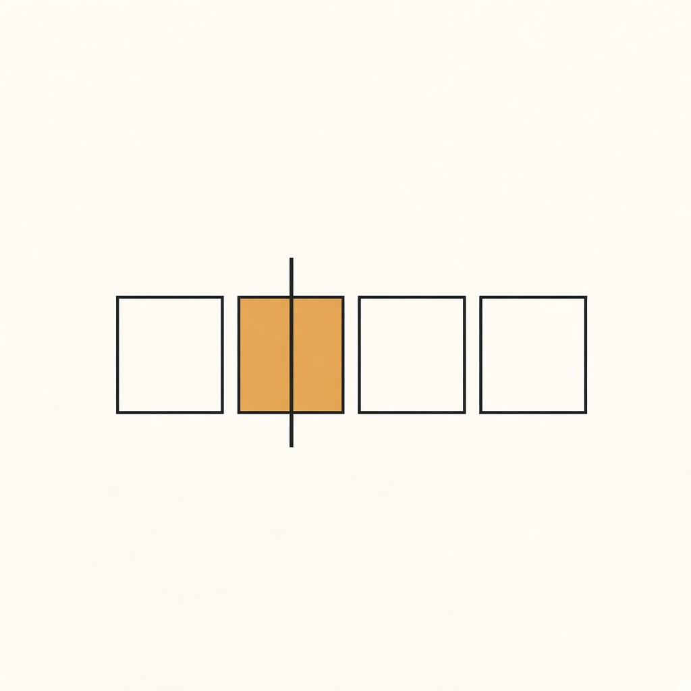

<p align="center">
  
</p>

# cellar

**cellar is a tiny self-hosted function runtime with built-in state.** You deploy
small Lua functions; each one runs inside a named **cell** that owns its own
SQLite database, so handlers read and write durable state with plain SQL and no
external database to operate. One static binary, one data directory, one
dashboard — think Cloudflare Durable Objects you can run on a laptop.

A single binary that hosts user-uploaded functions, where every named **cell** owns its
own SQLite database and is served by exactly one shard thread at a time.

```
POST /c/{cell}/{fn}   ->  shard queue  ->  the shard thread that owns that cell
                      ->  BEGIN IMMEDIATE
                      ->  Lua 5.4 function with db.* bound to that cell's database
                      ->  COMMIT (or ROLLBACK on any guest error)
```

Same cell key = same database = same thread = serialized. Different keys never share a
transaction, because they never share a connection. That is the whole design: **state
lives in the cell's database, not in the process**, so a cell can be evicted from memory
and come back with everything it knew.

**Operating or picking this up after a break?** Read the operations guide in
`docs/HANDOFF.md`: prerequisites, the commands that matter, the architecture
map, what is proven by which gate, and what is known not to work.

## Try it

```bash
zig build --release=safe
printf '%s' "$(openssl rand -hex 16)" > ./admin-token && chmod 600 ./admin-token
./zig-out/bin/cellar serve --listen 127.0.0.1:8080 --data ./data --admin-token-file ./admin-token
# (without a token source, serve generates one and prints it once)

# deploy a module (Lua, must return a table of functions)
cat > room.lua <<'LUA'
local M = {}
function M.join(body)
  db.exec("create table if not exists members (id integer primary key, name text)")
  db.exec("insert into members (name) values (?)", body)
  return tostring(db.value("select count(*) from members"))
end
function M.count(_) return tostring(db.value("select count(*) from members")) end
return M
LUA
./zig-out/bin/cellar deploy room.lua --cell room-42 --token-file ./admin-token

./zig-out/bin/cellar invoke room-42 join ada --token-file ./admin-token   # 1
./zig-out/bin/cellar invoke room-42 join bob --token-file ./admin-token   # 2
./zig-out/bin/cellar cells --token-file ./admin-token
```

The dashboard is at <http://127.0.0.1:8080/admin> — server-rendered, no build step, no
CDN, counters over SSE. It can deploy too: `GET /admin?token=<hex>` trades the token for
an `HttpOnly` cookie, then the form works.

## Example: a webhook receiver

`examples/webhook/` is the reference app: Stripe-style signature verification,
idempotency by event id, a bounded table, and rows that survive a restart.

```sh
zig build
examples/webhook/run.sh          # starts a server, deploys, sends signed events, restarts it
```

It is also the test. Seven assertions: first delivery accepted, repeat
deduplicated, new event accepted, tampered body rejected, stale timestamp
rejected, unsigned request rejected, and exactly two rows stored — then the
server is restarted and the count is read back through the runtime.

Building it found a real gap: guests could not see request headers, so no
webhook provider on earth could be verified. Handlers are now called as
`M.handler(body, headers)` with lowercased header names.

## Use cases

Anything where "a little code plus a little durable state per key" is the whole
app. Each bullet is one cell (or one cell per key) — no database to provision,
no migrations to run:

- **Webhook receivers.** Verify a signature, deduplicate by event id, store the
  row. `examples/webhook/` is a working Stripe-style receiver, idempotent
  across restarts.
- **Per-room or per-user state.** Chat rooms, game lobbies, counters, to-do
  lists — one cell per room or user, serialized by construction, so concurrent
  writes never interleave.
- **Scheduled nudges.** `alarm.set(delay_ms)` wakes the cell later with
  `on_alarm(payload)`: reminders, retries, expiry sweeps. The alarm lives in
  the cell's own transaction, so a rolled-back write leaves no phantom alarm.
- **Small JSON APIs.** A Lua table of functions plus `db.*` and `json.*` is a
  complete CRUD service for internal tools, prototypes, and demos.
- **Trusted automation with egress.** With `--allow-fetch`, a cell can call
  public APIs (status checks, data enrichment) and persist what comes back —
  e.g. a Hacker News digest function that fetches the top stories and serves
  them as JSON.

Guest code is trusted (see [What it is not](#what-it-is-not)), so these are
first-party and internal workloads — not a platform for untrusted uploaders.

## The guest API

Canonical reference: [`docs/BINDINGS.md`](docs/BINDINGS.md). Summary:

`db.exec(sql, ...)` — run a statement; returns rows (array of tables keyed by column).
`db.value(sql, ...)` — first column of the first row, or nil.
`db.one(sql, ...)` — first row as a table.
`db.run(sql, ...)` — run, discard rows.

`json.encode(v)` / `json.decode(s)` — JSON in both directions. Decoded `null` is
`json.null` (a sentinel table), because a Lua table cannot hold `nil` and an array
containing null would otherwise lose its length on a round trip.
`crypto.sha256(s)` / `crypto.hmac_sha256(key, s)` — hex digests.
`crypto.random(n)` — `n` (1..32) bytes as hex.
`time.now_ms()` / `time.now_s()` — wall clock.
`alarm.set(delay_ms)` — wake this cell in `delay_ms` by calling `on_alarm(payload)`;
one alarm per cell, stored in the cell's own database inside the invocation's
transaction, so an alarm that belongs to a rolled-back write does not exist.
`alarm.get()` / `alarm.clear()`.
`log.info(...)` / `log.warn(...)` / `log.error(...)` — stderr with the cell key; never
mixed into the response body.

There is no filesystem and no environment access. Outbound network is off
unless the operator enables it with `--allow-fetch 1` (`http.fetch`, with
private/metadata addresses blocked by default — see `docs/BINDINGS.md`). A
cell's only durable state is its database, and its only way out is the
response — that is the design, not an omission.

Transactions are the runtime's, not the guest's: a SQLite authorizer rejects
`TRANSACTION` (begin/commit/rollback), `SAVEPOINT`, `ATTACH`, `DETACH` and `PRAGMA`
coming from guest SQL, and `load_extension` is compiled out
(`-DSQLITE_OMIT_LOAD_EXTENSION`). One invocation is one transaction; a guest error
means the whole invocation's writes disappear, and a failed `COMMIT` fails the
invocation instead of reporting success.

## What it is not

- **Not a sandbox.** Guest code is trusted; the deadline and memory cap are availability
  guards, not a security boundary. Do not expose it to untrusted uploaders. What the VM
  does enforce (because they were one-line wins): the curated library set, no
  `load`/`loadfile`/`dofile` (so guest code cannot read or execute host files), no
  `io`/`os`/`package`/`debug`, no `__gc` finalizers (`collectgarbage` is nil and
  `setmetatable` refuses a `__gc` field — Lua runs them with the deadline hook
  disabled), and a yield that `http.fetch` did not ask for is rejected rather than
  turned into an outbound request. **Known limit:** a catastrophic Lua pattern still
  runs in C and cannot be preempted; it will hold a shard until the process is
  restarted.
- **Not a cluster.** One process, one node. Every seam for multi-node exists and is inert
  (ADR-0016); nothing outside `runtime/locator.zig` may assume a cell is local.
- **Not a general database.** No cross-cell queries, no cross-cell transactions.

## Layout

| path | role |
|---|---|
| `src/http/server.zig` | blocking HTTP/1.1, routing, admin auth, SSE |
| `src/http/admin.zig` + `admin/index.html` | dashboard: escape + substitute; builds the cells and deployments tables |
| `src/runtime/scheduler.zig` | shards, one thread each, queues, cell lifecycle, eviction, deploy |
| `src/runtime/locator.zig` | the only place that decides local vs remote (I14) |
| `src/runtime/registry.zig` | `state.db`: cells, deployments; single writer, published catalog |
| `src/store/sqlite.zig` | WAL, `synchronous=FULL`, statement cache, guest authorizer |
| `src/store/blob.zig` | content-addressed module store (`data/blobs/<sha>.bin`) |
| `src/store/paths.zig` | `data/cells/<sha256(key) hex>/` — relocatable (I15), key-checked on open |
| `src/vm/lua.zig` | budgeted allocator, count-hook deadline, module handle |
| `src/runtime/fetch.zig` | blocking HTTP(S) fetch; runs on the pool, never on a shard |
| `src/runtime/alarms.zig` | one timer thread; alarm rows live in the cell's own DB |
| `src/runtime/membership.zig`, `gossip.zig` | SWIM-style state and its wire format (no transport yet) |
| `src/vm/lua_bindings.zig` | `db.*` bindings |
| `src/vm/stdlib.zig` | guest `json`, `crypto`, `time`, `log`, `alarm` |
| `src/cli.zig` | `deploy` / `invoke` / `cells`, over the same HTTP API |

## Invariants worth knowing before you change something

- **I9** — code, tests and comments never cite plan phases or task ids (`gates/check-no-plan-refs.sh`).
- **I10** — only `src/store/sqlite.zig` and `src/vm/*.zig` may touch C headers
  (`gates/check-layers.sh`); the DB bindings live in `vm/lua_bindings.zig`, which is
  inside that allowlist on purpose.
- **I14** — placement is decided in one place: `Locator` returns `local | remote(addr)` and
  a remote answer is a 307 (`gates/check-locator.sh`). The gate is a heuristic on
  `cells.get(`/`findCell(`, not a proof; deploys still go local regardless of placement.
- **I15** — a cell directory is self-contained and relocatable: `key`, `db.sqlite`,
  `meta.json` (plus SQLite's `-wal`/`-shm` while open). No absolute paths.
- **I16** — never read `req.head` after reading the body; the buffer is reused. Copy into
  the request arena first. This one segfaulted once, so it is written down.

## Verification

```bash
zig build test          # unit tests, zero leaks
bash gates/run.sh       # L1, L2 and G1-G10 (twelve checks)
bash gates/restart.sh   # restart, and state.db loss: rows AND module must survive
bash gates/soak.sh      # 2000 requests / 20 cells: counters AND per-cell rows must agree
python3 gates/regress.py  # raw-socket regression probes (HTTP framing, auth edges)
```

Each gate prints one line and writes its evidence to `gates/evidence/`
(git-ignored). `G1` *is*
`zig build test`; `G2` builds `ReleaseSafe` and enforces the size ceiling in
`gates/thresholds.toml`; `G10` deploys, moves the whole data directory, and starts
again there. CI (`.github/workflows/ci.yml`) runs the format check, the unit
tests, and `gates/run.sh 3` (which adds G15, the locator check).

The soak is the gate that matters most. It checks the server's counter, the number of
responses, and the sum of every cell's `counters` row read back from its own database on
disk — three views that must agree, because each one alone can lie (a failed
deploy must never leave a cell silently serving the built-in fixture, which is
why deploys are verified, not assumed, and why `restart.sh` proves deployments
survive a restart and a lost `state.db`).

## Status

Done: cell scheduler with shard threads and per-cell transactions · SQLite per cell with
caps · atomic content-addressed blobs verified on read · deploy with ordered hot swap (a
failed compile cannot break a running cell, and is never recorded) · token-gated deploys
(`/admin`, `/admin/cells` and `/admin/events` are readable without one) · LRU eviction
under `--max-cells` with drain preconditions · connection cap · scriptable CLI ·
dashboard with form deploy and SSE · SWIM-style membership state machine (no transport).

Not done: cluster transport and lease/handoff (`docs/CLUSTER.md`, ADR-0016) · hibernation ·
socket read/write timeouts · `--max-cells` is enforced per shard, so the ceiling is
`shards × max_cells` (`/healthz` reports both to make that checkable) · deploys are always
local, even when placement says otherwise · an external watchdog for C-side preemption
(a catastrophic Lua pattern still blocks its shard) · admin session/CSRF redesign if cells
ever return HTML.

The decision memo comparing this design with Durable Objects, celld, Rivet and
Orleans is `docs/DECISIONS.md`; the ADRs are `docs/adr/`; changes are in
`CHANGELOG.md`.

Requires Zig 0.17.0. Linux (x86_64/aarch64) is the deployment target and
runs the full gate suite in CI; macOS (arm64) builds, tests, and serves
locally (`zig build && zig build test`). Lua 5.4 via the `zlua` package;
SQLite vendored in `vendor/sqlite3`. Licensed under MIT — see `LICENSE`.

## Observability

`GET /metrics` — Prometheus text format, no dependency. Counters by outcome plus one
latency histogram per outcome (buckets are hand-picked seconds, not powers of two).

Every invoke response carries `x-cellar-invocation: <16 hex>`, and every invocation
emits one JSON line to stderr with the same id:

```json
{"ts":1793809361.280,"level":"warn","msg":"invoke","id":"81df43fbddf7f197","cell":"room","fn":"boom","outcome":"guest_error","duration_ms":93.296}
```

Successful invocations faster than 100 ms are sampled 1-in-100 (at 1k/s a line each is
~20 GB/day); every failure and every slow call is logged. `grep` the id from the
header to find the line.

## Exposure

Guest code is trusted (see the warning at the top), so the default is: the data plane
is open, and only control-plane writes need a token.

- `--admin-token-file F` (or `--admin-token T`, or `CELLAR_ADMIN_TOKEN`) — required for
  `/admin/deploy` and `/admin/evict`. If none is set, a random one is generated and
  printed once at startup; it is lost on restart, so prefer the file (mode 0600). The
  dashboard trades it for an HttpOnly, SameSite=Strict cookie via `GET /admin?token=…`,
  with `Secure` added when the request is HTTPS or the listener is not loopback
  (`--cookie-secure` overrides).
- `--cell-token-file F` / `--cell-token T` / `CELLAR_CELL_TOKEN` — optional password for
  `/c/...`, accepted as `X-Cellar-Token` or `Authorization: Bearer`. Deliberately
  separate from the admin token: handing a client the invoke password must not grant
  deploy rights. The CLI takes `--token-file F` (or `CELLAR_TOKEN`) so its secret also
  stays out of `ps`.
- Cookies are **dashboard-only**. `/c/...` never accepts one, so a browser-held secret
  cannot invoke cells.
- Both comparisons are constant-time (hash, then `timing_safe.eql`).
- **Per-cell keys**: `POST /admin/key?cell=K` mints a 32-byte token, returns it once,
  and stores only its SHA-256 in `state.db`. A cell with a key requires it and ignores
  the shared `--cell-token` — one leaked global password cannot open every cell.
  Unkeyed cells keep using the shared token.
- **Rotation with overlap**: a cell may hold several live keys. Mint a second with
  `POST /admin/key?cell=K`, move the client, then `POST /admin/revoke?key_id=ID`.
  Revoked rows stay in `state.db` with `revoked_at` set, so the record of the key
  survives; several live keys are accepted simultaneously during the overlap.

Behind a reverse proxy, terminate TLS there; cellar speaks plain HTTP.

`--rate-per-s N` (with `--rate-burst B`, default = N) limits requests per cell —
keyed on the cell, not the caller, because the damage one actor can do here is make a
single cell hot on a single shard. Refusals are `429` with `retry-after: 1`, and one
hot cell does not starve another. Off by default.

There is still no notion of *who* is calling — one secret per plane, or one per cell.

Admin **reads** (`/admin`, `/admin/cells`, `/admin/cells/<key>`) are open on a loopback
listener and require the admin token anywhere else; `--admin-open 1` opts back in. The
dashboard's `?token=` unlock still works, because a browser cannot send a header before
it has a cookie.

`POST /admin/snapshot?cell=K` (admin token) writes a consistent `VACUUM INTO` copy to
`<data>/snapshots/<cell>-<unix>.db`, taken on the cell's own thread with no concurrent
writer. Restore is: stop the node, replace `cells/<sha>/db.sqlite` **and delete
`db.sqlite-wal`/`-shm`** (a WAL belonging to the replaced file is how a restore
resurrects neither state), then start. `gates/snapshot.py` performs exactly that drill.

A cell pinned to a blob that cannot be read now refuses to start instead of quietly
running the built-in module: the invoke fails with `ModuleUnavailable`, the log names the
cell and the digest, and `meta.json` keeps its pin. Running different code against a
cell's real data is the one failure mode with no safe fallback.

`POST /admin/gc?keep=N` (admin token) prunes deployment history to the newest N versions
per module and deletes blob files that no live cell, no surviving deployment and no
`meta.json` pin refers to (the last is what keeps ADR-0007's recovery path intact when
`state.db` is lost). `keep` must be at least 1. Blobs younger than `--gc-min-age-s` (default 60) are never touched: a deploy may have
written one and not yet pinned it. The blob store is content-addressed, so repeating the
same deploy stores one blob, not N.
